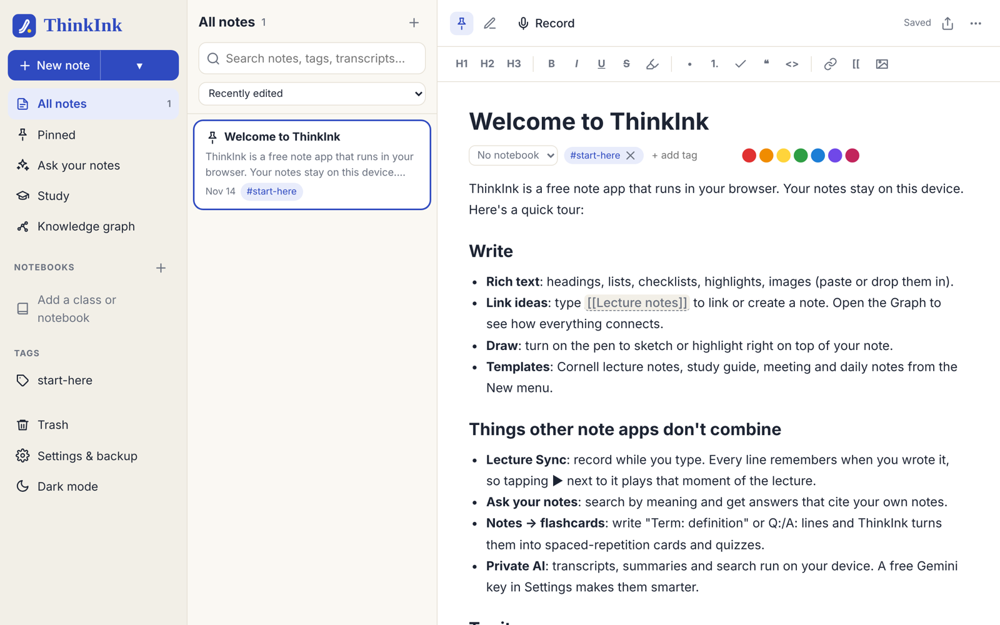

# ThinkInk

**AI notes that study with you.** ThinkInk is a free note-taking app that runs entirely in your browser. You write, draw and record lectures. ThinkInk links your ideas, answers questions from your own notes, and turns them into flashcards and quizzes.

**[Open ThinkInk →](https://nmeko.github.io/ThinkInk/)**: no account, no install, nothing to pay.



## What it does

### Everything you expect from a note app
| | |
|---|---|
| **Rich text** | Headings, bullet and numbered lists, checklists, quotes, code, highlights, links. Paste or drop images straight in. |
| **Organize** | Notebooks (one per class or project), tags, pinned notes, colors, and a trash you can restore from. |
| **Find anything** | Instant search across titles, tags, text and lecture transcripts, plus a command palette (`Ctrl/⌘ K`). |
| **Templates** | Cornell lecture notes, study guide, meeting notes and daily notes. |
| **Draw** | Sketch or highlight on top of any note with a pressure-sensitive pen (works with a stylus or Apple Pencil). |
| **Share & export** | Send a note as a link (the note travels inside the link, no server involved), export Markdown, print or save as PDF, and back up everything to one file. |
| **Works anywhere** | Phone, tablet and desktop layouts, dark mode, installable as an app (PWA). |

### What makes ThinkInk different
Popular note apps each do one of these well. ThinkInk puts them together:

- **Lecture Sync**: press Record and keep typing. Every line remembers the moment you wrote it, so tapping ▶ next to a line plays that part of the lecture. ThinkInk can also transcribe the recording into searchable text, on your device.
- **Ask your notes**: ask a question in plain words. ThinkInk searches by *meaning*, not exact keywords, shows the best matching passages and, with a Gemini key, writes an answer that cites which notes it came from.
- **Notes become flashcards**: lines like `Term: definition` or `Q:` / `A:` turn into flashcards automatically. A spaced-repetition scheduler (SM-2, the method behind Anki) brings each card back just before you'd forget it. Practice quizzes are built from the same cards.
- **Linked thinking**: type `[[Another note]]` to link notes (or create one). Every note shows what links to it, and the knowledge graph shows how your ideas connect.
- **Private by default**: notes are stored on your device (IndexedDB). The built-in AI models run in your browser, so your notes never leave it unless you choose to use Gemini or share a link.

## AI: free, two ways

| | Built in (default) | With a free Gemini key (optional) |
|---|---|---|
| Search by meaning, related notes | ✓ on device | ✓ |
| Lecture transcription | ✓ on device (Whisper) | ✓ |
| Summaries | Key sentences picked from your note | Written summary |
| Flashcards and quizzes | From patterns in your notes | Written by AI |
| Answers to questions | Best matching passages | Written answer with sources |

The on-device models ([all-MiniLM-L6-v2](https://huggingface.co/Xenova/all-MiniLM-L6-v2) and [Whisper tiny](https://huggingface.co/onnx-community/whisper-tiny.en)) download once, about 60 MB, the first time you use them. To turn on the smarter features, get a free key at [Google AI Studio](https://aistudio.google.com/apikey) and paste it in **Settings**. The key is stored only in your browser and sent only to Google.

## Privacy

- Notes, drawings, recordings and flashcards are stored in your browser's IndexedDB. Clearing site data deletes them, so use **Settings → Download backup** now and then.
- Nothing is sent anywhere unless you (a) use a Gemini key, which sends the text of the notes involved to Google's Gemini API, or (b) share a link, which contains the note itself.
- Shared links are validated before anything is saved: only known content types are rendered and malformed drawings are dropped.

## Run it locally

Requires Node 22 (see `.nvmrc`).

```bash
npm ci --ignore-scripts   # skips an optional native ONNX download the browser build doesn't use
npm run dev               # http://localhost:5173
```

| Command | What it does |
|---|---|
| `npm run dev` | Start the dev server |
| `npm run lint` | Lint with oxlint |
| `npm run typecheck` | Type check |
| `npm test` | Unit tests (Vitest) |
| `npm run build` | Type check and build to `dist/` |

Pushing to `main` runs the checks and publishes `dist/` to GitHub Pages (`.github/workflows/deploy.yml`). In the repo's **Settings → Pages**, set **Source** to **GitHub Actions** once.

## How it's built

React 19 + TypeScript + Vite · [TipTap](https://tiptap.dev) editor · [Dexie](https://dexie.org) (IndexedDB) · [Transformers.js](https://huggingface.co/docs/transformers.js) in a Web Worker · d3-force graph · lz-string share links.

```
src/
  lib/db.ts          all storage: the one file to swap for a cloud database later
  lib/ai/            on-device models (worker.ts, local.ts) and Gemini (gemini.ts)
  lib/srs.ts         spaced-repetition scheduler
  lib/flashcards.ts  turns note patterns into cards
  lib/share.ts       share links (encode + validate)
  editor/            [[wiki links]] and Lecture Sync timestamps
  components/        the app's screens
```

**Adding accounts or sync later:** every read and write goes through `src/lib/db.ts`. To sync with a server or cloud database, implement the same functions there against your API; the screens don't change.

## Credits

ThinkInk started as **ThinkNInk**, a PHP/MySQL team project for creating visual notes, sharing them, and generating study guides. This version rebuilds it as a free browser app with AI features.
